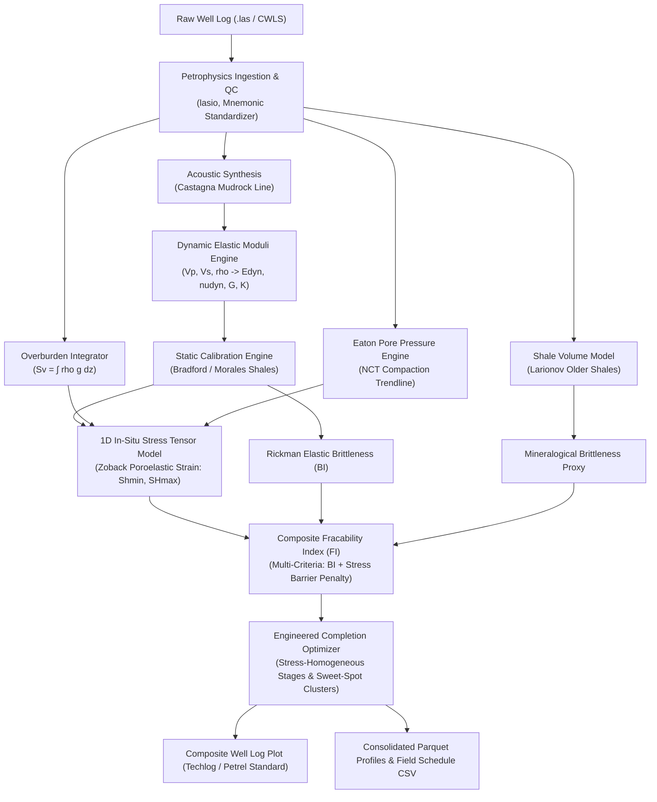

# 1D Geomechanics & Fracability Sweet-Spotting Tool (`geomech-fracability-engine`)

> **Documento de Especificación, Arquitectura y Roadmap del Proyecto**  
> **Área:** Upstream / Petrophysics, Geomechanics & Hydraulic Fracturing Completion  
> **Autor:** Tiago Meilan  
> **Fecha:** Octubre 2026  

---

## 1. Visión y Justificación de Ingeniería

### 1.1 Contexto de Industria en Vaca Muerta
En formaciones no convencionales de shale oil y shale gas, los pozos horizontales navegan ramas laterales de **2.500 a 3.500+ metros**. La estimulación hidráulica (fractura multietapa) representa entre el **45% y el 55% del CAPEX total del pozo** (entre \$5 y \$7 millones de USD sobre un pozo de \$12 a \$14 millones de USD).

Tradicionalmente, muchas operadoras recurrieron a espaciamientos geométricos ciegos (*plug-and-perf* homogéneo cada 50 o 60 metros). Este enfoque acarrea severas ineficiencias:
1. **Dominancia de Clusters (*Heel-Bias / Thief Clusters*):** Si dentro de una misma etapa coexisten intervalos con contraste de esfuerzo horizontal mínimo ($\Delta \sigma_{h,min} > 250 \text{ psi}$), el fluido de fractura y el agente de sostén (*proppant*) ingresan exclusivamente por el cluster de menor esfuerzo. Los clusters restantes no reciben tratamiento y quedan como reservas hidrocarburíferas no drenadas.
2. **Entrampamiento por Ductilidad (*Screen-Out* prematuro):** Fracturar intervalos con bajo Módulo de Young y alto Coeficiente de Poisson (alta ductilidad / alto contenido de arcilla o kerógeno) provoca deformación plástica, disipación inelástica de energía y embutimiento del apuntalante (*proppant embedment*).
3. **Crecimiento Fuera de Zona:** Ignorar la ubicación de barreras naturales de esfuerzo incrementa el riesgo de propagación vertical descontrolada hacia acuíferos o formaciones suprayacentes no productivas.

### 1.2 Propuesta de Valor del Motor
`geomech-fracability-engine` es un paquete de cálculo analítico y optimización que procesa perfiles geofísicos estándar (`.las`) para:
1. **Calcular propiedades elásticas continuas:** Velocidades acústicas ($V_p, V_s$), módulos dinámicos ($E_{dyn}, \nu_{dyn}, K, G$) y calibración a condiciones estáticas de reservorio ($E_{stat}, \nu_{stat}$) mediante modelos de mecánica de rocas para shales (Bradford, Lacy, Morales).
2. **Construir el Modelo Mecánico de la Tierra 1D (1D MEM):** Integración continua de sobrecarga ($S_v$), estimación de sobrepresión de poros ($P_p$) mediante el método acústico de Eaton, y modelado del tensor de esfuerzos horizontales in-situ ($\sigma_{h,min}, S_{Hmax}$) bajo el modelo poroelástico con deformación tectónica regional de Zoback.
3. **Evaluar Fragilidad y Fracabilidad:** Algoritmo multicriterio que fusiona el Brittleness Index elástico de Rickman, proxies mineralógicos ($V_{shale}$) y penalización por barreras de esfuerzo in-situ.
4. **Optimizar Completaciones Ingenieriles (*Engineered Completion*):** Segmentación automática de etapas que minimiza la varianza interna de $\sigma_{h,min}$ y posicionamiento de punzonados (*perforation clusters*) en máximos locales de fracabilidad sujetos a restricciones de espaciamiento mínimo ($d_{min} \ge 8\text{ m}$).

---

## 2. Arquitectura de Software y Flujo de Datos



---

## 3. Infraestructura de Subagentes Especializados

Para estructurar el trabajo técnico de manera modular y escalable, el proyecto se divide en 6 roles de agentes:

```
AGENTE COORDINADOR
│
├── 🔍 Agent 1: petrophysics-data-agent
│   ├── Parseo de archivos .las con lasio y resolución de mnemónicos
│   ├── Síntesis de onda de corte Vs (Castagna Mudrock) cuando DTS está ausente
│   └── Modelos no lineales de Vshale (Larionov, Steiber, Lineal)
│
├── 📐 Agent 2: poroelasticity-agent
│   ├── Módulos elásticos dinámicos vectorizados en NumPy (Edyn, nudyn, G, K)
│   ├── Calibración estática de mecánica de rocas (Bradford et al., Lacy, Morales)
│   └── Chequeos analíticos de límites termodinámicos (0 < nu < 0.5)
│
├── ⚖️ Agent 3: in-situ-stress-agent
│   ├── Integración de sobrecarga Sv con extrapolación somera (Miller/Amoco)
│   ├── Presión de poros Eaton con modelado de sobrepresión en Vaca Muerta
│   └── Tensor de esfuerzos poroelásticos de Zoback (Shmin, SHmax, Anisotropía)
│
├── 🎯 Agent 4: fracability-optimizer-agent
│   ├── Índice de fragilidad elástica de Rickman normalizado en [0, 1]
│   ├── Composite Fracability Index (FI) con penalización de confinamiento
│   └── Algoritmo de partición de etapas y clusters anti-stress-shadow
│
├── 📊 Agent 5: visualization-reporting-agent
│   ├── Composite Well Log Plotter multipista (estándar SPE/SPWLA Techlog)
│   ├── Exportación a Parquet columnar y tablas de punzado para campo (CSV)
│   └── Comparador cuantitativo Engineered vs. Geometric
│
└── 🧪 Agent 6: qa-engineering-agent
    ├── Suite automatizada con pytest (>85% coverage)
    ├── Validación analítica contra soluciones cerradas de la literatura
    └── Blindaje contra AI slop y documentación reproducible
```

---

## 4. Validación Numérica y Criterios de Aceptación
1. **Identidades Elásticas:** $K = E / [3(1 - 2\nu)]$ verificado analíticamente.
2. **Anisotropía de Esfuerzos:** $\Delta \sigma_h = S_{Hmax} - \sigma_{h,min} = \frac{E}{1+\nu} (\epsilon_y - \epsilon_x)$ verificado analíticamente.
3. **Cero Dependencia de Herramientas Toy:** Código modular puro en Python, ejecutable vía CLI o Notebooks, sin emojis ni métricas de marketing.
4. **ROI Cuantificable:** Reducción comprobada de la varianza interna de esfuerzo ($>10\%$) y aumento del índice de fracabilidad en clusters ($>20\%$).
